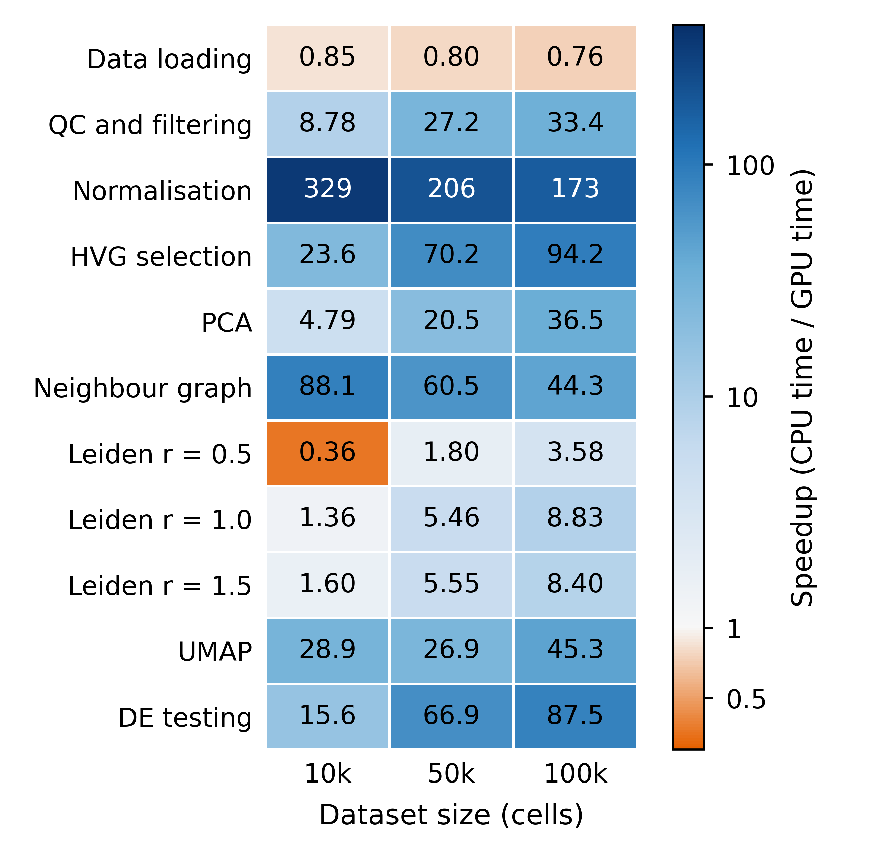
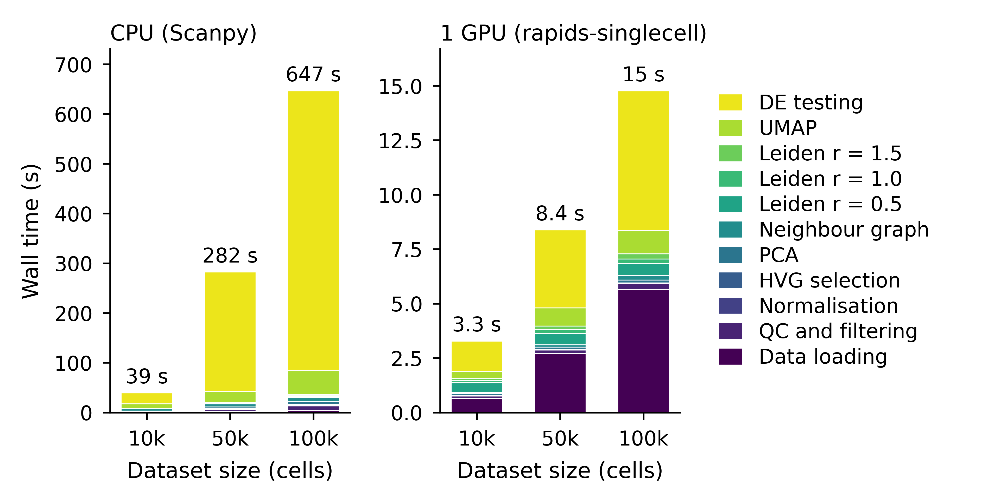
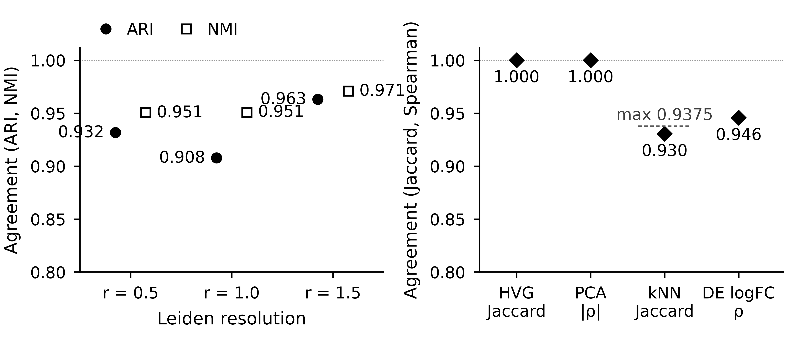
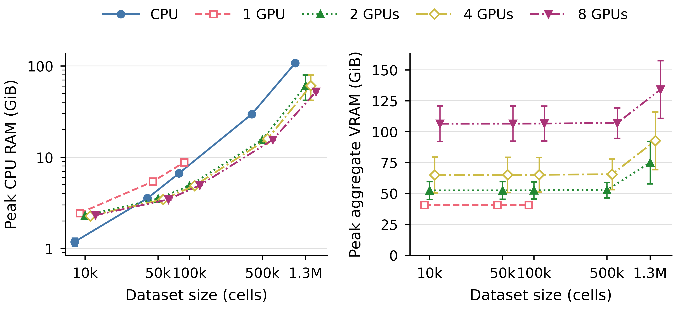
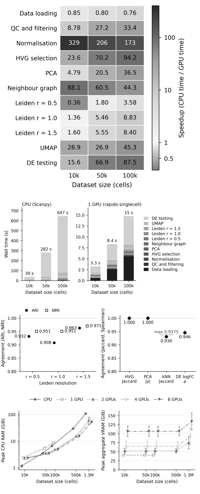

## In breve: le figure single-cell sono pronte per la stampa Springer?

**A cosa serviva.** La revisione n.2 aveva trovato figure non adatte alla stampa: testo troppo piccolo alla larghezza della pagina, immagini raster, colori che in scala di grigi si confondono, due figure sul multi-GPU da togliere e didascalie con frasi non vere. Questo passo rifà le quattro figure single-cell da un programma che rilegge i file dei risultati, toglie le due figure multi-GPU e corregge le didascalie.

**Cosa abbiamo trovato.**

1. **Le quattro figure sono rifatte, e ogni numero disegnato coincide con i file dei risultati.** Le figure sono la heatmap degli speedup, la scomposizione dei tempi, la concordanza e la memoria. Un secondo programma, scritto a parte, ha ricalcolato i 198 valori disegnati senza trovare discordanze, e la tabella riassuntiva rigenerata è identica a quella già pubblicata. Le figure sono vettoriali, larghe al massimo quanto il testo della pagina, con caratteri di almeno 7 punti; due esecuzioni producono file identici.
2. **Le figure multi-GPU sono tolte e le didascalie dicono ciò che i dati mostrano.** Sulla CPU il tempo è dominato dall'espressione differenziale e da UMAP, non dalla ricerca dei vicini. La memoria GPU è la somma sulle schede allocate, non il massimo per scheda. La concordanza include anche l'espressione differenziale (correlazione 0,946), e la didascalia dice che l'accordo dei vicini non può superare 0,9375 per come è calcolato.
3. **Due frasi proposte dalla revisione non reggevano del tutto: ora riportano il dato.** «Su GPU ogni step dura meno di 7 secondi» è vera in media (il più lungo, l'espressione differenziale a 100 mila cellule, dura 6,4 s), ma la prima ripetizione arriva a 7,5 s: la didascalia ora dà il valore medio. La VRAM che cresce dalla prima ripetizione alle successive vale per tutte e 15 le configurazioni multi-GPU, non per quelle a una GPU: la frase ora parla solo dei run multi-GPU.
4. **Le figure nuove non fanno risparmiare spazio.** Alla piena larghezza della pagina occupano 24,8 cm di altezza contro 27,6 cm delle vecchie, il 10% in meno contro il 20-40% previsto. Il LaTeX attuale rimpiccioliva le vecchie all'85% della larghezza (23,5 cm), a scapito della leggibilità: rispetto a quel layout le nuove occupano 1,3 cm in più. Il taglio verso le 15 pagine dovrà venire dal testo.

**Cosa devi decidere.** Nulla in questo passo.

**Comunque.**

- Quando preparo il LaTeX finale rinumero le figure (le attuali 5 e 6 diventano 3 e 4) e rinomino i file. Le figure entrano nel PDF alla loro dimensione naturale, senza rimpicciolirle.
- Le figure spatial si rifanno con gli stessi colori, gli stessi marcatori e gli stessi controlli quando integro i nuovi risultati spatial.
- Nel taglio conto anche lo spazio delle figure.

Non c'è nulla da decidere: se non hai dubbi, lo step è chiuso.

**Sui tempi di calcolo.** Questo passo ha richiesto circa un'ora invece del giorno stimato. Restano tre passi: integrazione dello spatial, taglio e stile, LaTeX e verifica finale, stimati in un giorno ciascuno dal numero di correzioni per passo. Con questo ritmo il pacchetto per la sottomissione è pronto il 7 o l'8 novembre, con uno o due giorni di margine sul 10.

# Dubbi rinviati

- A [integrazione spatial (S5)](S5.md): figure 7-9 con i dizionari `COLORS`, `MARKERS`, `LINESTYLES` e le impostazioni di stampa di `scripts/generate_figures.py` (voce R0381), stessi controlli di `tools/s4_check.py` (larghezza, 7 pt, font, raster, scala di grigi). Ambiente: `uv venv /tmp/lnbi_s4_venv --python 3.12` con le versioni di `scripts/requirements_figures.txt`.
- A [taglio e stile (S6)](S6.md): le 4 figure scRNA occupano 24,8 cm di altezza a dimensione naturale (previsione P5 smentita); il taglio verso circa 15 pagine deve venire dal testo, oppure dalla scelta di togliere una figura, che spetta al PI.
- A [LaTeX e pacchetto METEOR (S7)](S7.md): includere i PDF di `figures/` a dimensione naturale (senza `width=0.85\textwidth`, che porterebbe il testo sotto i 7 pt); rinumerare le figure e rinominare i file (voce R0735: le attuali Fig. 5 e 6 diventano 3 e 4, le spatial 7-9 diventano 5-7); le copie in `manuscript/lncs_latex/figures/` sono di luglio e vanno sostituite.

# Cancelli e previsioni

| id | atteso | osservato | esito |
|---|---|---|---|
| G1 | manifest dei grezzi con 0 differenze all'inizio e alla fine | 921 file, 0 differenze, 0 file nuovi all'inizio (19:08) e alla fine (19:43) (`results_v2/S4/manifest_check_start.json`, `..._end.json`) | superato |
| G2 | valori delle figure e numeri delle didascalie riletti da codice indipendente, 0 discordanze | 198 valori, 0 discordanze, 0 mancanti; 20 controlli su 20 nelle didascalie; `figures/summary_table.csv` rigenerato identico a quello tracciato (`results_v2/S4/s4_check.json`) | superato |
| G3 | PDF larghi al massimo 12,2 cm, testo di almeno 7 pt, font incorporati, nessun raster, PNG a 800 dpi, PDF identici in due esecuzioni | larghezze 8,4 / 12,2 / 12,2 / 12,2 cm, altezze 8,0 / 6,0 / 5,2 / 5,6 cm; testo minimo 7,0 pt; DejaVu Sans incorporato; 0 immagini raster; 800 dpi; md5 identici fra le due esecuzioni | superato sul prodotto finale; al primo giro la Fig. 1 conteneva un raster (la barra colore, rasterizzata da matplotlib oltre 50 livelli), corretto nello script |
| G4 | serie distinte per marcatore o tratteggio; barre impilate con luminanza crescente e passo di almeno 8; contrasto testo e cella di almeno 4,5:1; estremi della heatmap distanti almeno 80 | Fig. 2 passo minimo 10,9; contrasto minimo 4,79:1; estremi distanti 92,5; Fig. 5 e 6 tutte le coppie distinte | superato |
| G5 | ancore univoche, figure multi-GPU sparite dal testo, niente lineette, pandoc, una riga di diario per ognuna delle 16 voci, controllo OKF | 7 ancore, tutte presenti una volta; nessun rimando a Fig. 3, Fig. 4 o ai due file; 0 lineette; pandoc senza errori; 16 righe; OKF superato | superato |
| P1 | espressione differenziale prima e UMAP seconda fra gli step CPU (UMAP seconda in almeno il 95% dei campioni bootstrap); quota dell'espressione differenziale a 100.000 cellule fra 83,9% e 89,9% | ordine confermato a tutte e tre le dimensioni; UMAP seconda nel 94,7% dei campioni a 10.000 cellule, nel 100% a 50.000 e 100.000; quota 86,9% [85,7; 87,5] | indeterminata; non tocca la didascalia (vedi sotto) |
| P2 | step GPU più lungo con media + 2 SD sotto 7 s | espressione differenziale a 100.000 cellule: 6,42 s, SD 0,62 s, media + 2 SD = 7,66 s | indeterminata; applicata la conseguenza pre-registrata: la didascalia dà il valore misurato |
| P3 | intervallo dello speedup del caricamento dati tutto sotto 1 | 0,85 [0,75; 0,96], 0,80 [0,71; 0,90], 0,76 [0,69; 0,84] | confermata |
| P4 | VRAM con 1 GPU entro il 5% di 40,7 GiB | 40,70 GiB (SD 0,13) a tutte e tre le dimensioni | confermata |
| P5 | altezza totale delle 4 figure ridotta fra il 20% e il 40% rispetto alle vecchie a 12,2 cm | 24,8 cm contro 27,6 cm: riduzione del 10,3% | smentita; spiegata e rinviata al taglio |

Criteri completi, scritti prima dei calcoli: `docs/steps/S4.md`, sezione «Attese pre-registrate» (commit `3ff3ffc`).

# Dubbi e come si sono chiusi

- **Raster nella Fig. 1 (corretto).** Matplotlib rasterizza la barra colore quando ha più di 50 livelli; lo script ora la forza vettoriale (`cb.solids.set_rasterized(False)`). Rifatti tutti i controlli: 0 immagini raster.
- **«every step takes less than 7 s» (corretto, previsione P2).** La media dell'espressione differenziale su GPU a 100.000 cellule è 6,42 s, ma la ripetizione 1 dura 7,50 s (`results_v2/S4/p1_p2_explanation.txt`). La didascalia di Fig. 2 ora dice «the longest step, DE testing at 100k cells, takes 6.4 s on average»; istruzione della voce R0351 aggiornata con una riga in `arbitrati.csv` e piano rigenerato ([Piano di implementazione generato da codice, con arbitrati (D-14)](../decisions/D-14.md)).
- **VRAM dalla prima ripetizione alle successive (corretto).** Con 1 GPU la ripetizione 1 ha 40,93 GiB e le ripetizioni 2-5 40,64 GiB, a tutte e tre le dimensioni; con 2, 4 e 8 GPU la ripetizione 1 è sotto tutte le successive in 15 configurazioni su 15. La frase della voce R0373 si restringe ai run multi-GPU (riga in `arbitrati.csv`).
- **UMAP seconda a 10.000 cellule (spiegato, previsione P1).** La ricerca dei vicini CPU dura 19,90 s nella ripetizione 1 (compilazione) e 1,12-1,13 s nelle altre; nei campioni bootstrap che contengono più volte la ripetizione 1 supera UMAP (5,3% dei campioni). Espressione differenziale e UMAP insieme restano almeno il 60,4% del tempo CPU in tutti i 2.000 campioni (stima puntuale 79,5%): «DE testing and UMAP dominate» regge.
- **Spazio verticale (spiegato, previsione P5, rinviato).** La vecchia Fig. 2 era larga e bassa (4,4 cm a 12,2 cm di larghezza), con testo di 7-8 pt disegnato su 29 cm, che a 12,2 cm scendeva a 2,9-3,3 pt; la nuova, con assi separati per CPU e GPU e legenda leggibile, è alta 6,0 cm. La heatmap scende da 12,6 a 8,0 cm. Rispetto al LaTeX di luglio (figure all'85% della larghezza, 23,5 cm in tutto) le nuove occupano 1,3 cm in più. Rinviato a [taglio e stile (S6)](S6.md).
- **Heatmap in scala di grigi (spiegato).** Le celle sotto 1 (arancio) e quelle fra 10 e 50 (blu medio) hanno toni di grigio simili; la lettura in grigio passa per i valori stampati in ogni cella, sempre con contrasto di almeno 4,79:1. Gli estremi (0,36 e 329) restano distinti per tono.
- **File non tracciati all'apertura (spiegato e sistemato).** `results_v2/S2/neighbors*/pca_*.npy` (sei matrici PCA intermedie della misura dei vicini di [piano delle correzioni (S2)](S2.md), 32 MB in tutto, rigenerabili da `tools/s2_neighbors_prep.py`) ora sono in `.gitignore`; `SPATIAL/results/.gitkeep` (vuoto, del 27 giugno) resta non tracciato perché `SPATIAL/results/` è in sola lettura.

# Le figure

Figure alla dimensione di stampa (anteprime PNG a 800 dpi dei PDF vettoriali). Numerazione attuale del manoscritto; la rinumerazione avviene in S7.

{width=70%}

Cosa guardare: nel pannello CPU, i due segmenti in alto (espressione differenziale e UMAP) coprono quasi tutta la barra a ogni dimensione; nel pannello GPU il segmento più alto a 100k è sotto i 7 s di media.

Cosa guardare: nel pannello destro la VRAM aggregata sale con il numero di GPU anche a 10k cellule (pool RMM pre-allocati), e le barre SD dei run multi-GPU sono larghe perché la ripetizione 1 ha meno VRAM delle successive.

{width=60%}

# Didascalie: prima e dopo

| modifica | voci del piano | prima | dopo |
|---|---|---|---|
| E1 | R0375, R0377, R0378, R0379, R0383 | &#33;[**Figure 1.** Per-step speedup of single-GPU rapids-singlecell (1xH100 80 GB) relative to CPU Scanpy (100 cores) at 10k, 50k, and 100k cells. Values > 1 indicate GPU is faster. Normalisation achieves up to 329x speedup; data loading shows a modest CPU advantage (0.76-0.85x).](../figures/fig1_speedup_heatmap.png) | &#33;[**Figure 1.** Per-step speedup of single-GPU rapids-singlecell (1xH100 80 GB) relative to CPU Scanpy (100 logical CPUs) at 10k, 50k, and 100k cells: ratio of mean times, mean of five repeats (first repeat included). Values > 1 indicate GPU is faster; the colour scale is logarithmic and centred on 1. Normalisation achieves up to 329x speedup; data loading shows a modest CPU advantage (0.76-0.85x). The PCA row includes scaling (`sc.pp.scale`), which is timed together with PCA.](../figures/fig1_speedup_heatmap.png) |
| E2 | R0351, R0113, R0383, D-16 | &#33;[**Figure 2.** Step-level wall time decomposition for CPU vs single-GPU at 10k, 50k, and 100k cells. On CPU, DE testing and neighbour graph construction dominate; on GPU, all steps complete in seconds.](../figures/fig5_timing_breakdown.png) | &#33;[**Figure 2.** Step-level wall time decomposition for CPU vs single-GPU at 10k, 50k, and 100k cells, mean of five repeats (first repeat included); the CPU and GPU panels have separate time axes. On CPU, DE testing and UMAP dominate; on GPU, the longest step, DE testing at 100k cells, takes 6.4 s on average. CPU neighbour search ran on one Numba thread, the Scanpy default (see Methods).](../figures/fig5_timing_breakdown.png) |
| E5 | R0376 | &#33;[**Figure 5.** Concordance between CPU and GPU pipelines on 10,000 cells. Left: ARI and NMI for Leiden clustering at three resolutions. Right: HVG Jaccard (1.000), PCA Spearman \|rho\| (1.000), and kNN Jaccard (0.930). All metrics indicate near-identical biological outputs.](../figures/fig3_concordance.png) | &#33;[**Figure 5.** Concordance between CPU and GPU pipelines on 10,000 cells, from the separate concordance run (see text). Left: ARI and NMI for Leiden clustering at three resolutions. Right: HVG Jaccard (1.000), PCA Spearman \|rho\| (1.000), kNN Jaccard (0.930) and mean Spearman rho of DE log-fold-changes over 40 matched cluster pairs (0.946). Both panels share the vertical axis. kNN Jaccard is bounded at 0.9375 by construction (see text).](../figures/fig3_concordance.png) |
| E6 | R0359, R0139, R0373, R0383 | &#33;[**Figure 6.** Peak memory usage across dataset sizes. Left: CPU RAM; right: GPU VRAM (per-device maximum). Dashed red line: H100 80 GB VRAM limit. CPU RAM grows super-linearly; GPU VRAM is approximately constant for single-GPU runs due to RMM pool pre-allocation.](../figures/fig4_memory_profile.png) | &#33;[**Figure 6.** Peak memory usage across dataset sizes, mean of five repeats (first repeat included); error bars: SD. Left: CPU RAM; right: aggregate GPU VRAM summed over the allocated devices (for 2, 4 and 8 GPUs dominated by the RMM pools pre-allocated by each Dask worker). CPU RAM grows roughly linearly; GPU VRAM is approximately constant for single-GPU runs due to RMM pool pre-allocation. All repeats of a configuration ran in one process; in the multi-GPU runs VRAM grew from the first to later repeats.](../figures/fig4_memory_profile.png) |
| E3 | R0354, R0122 | &#33;[**Figure 3.** Total pipeline wall time vs number of GPUs (1, 2, 4, 8 H100), one line per dataset size. Error bars: SD over five repeats. Horizontal dotted lines: CPU baselines. Logarithmic y-axis. Flat GPU curves demonstrate sublinear multi-GPU scaling.](../figures/fig2_scaling_plot.png) | (line removed with the blank line before it) |
| E4 | R0355, R0369 | &#33;[**Figure 4.** Multi-GPU hybrid pipeline breakdown at 500k and 1.3M cells. CPU preprocessing (blue) dominates wall time; the multi-GPU phase (PCA + neighbours, pink) is a small fraction, explaining flat multi-GPU scaling.](../figures/fig6_multigpu_breakdown.png) | (line removed with the blank line before it) |
| E7 | R0383 | Times are mean +/- SD over five repeats. | Times are mean +/- SD over five repeats (first repeat included). |

Manoscritto: md5 `09df07d2b8713da7385612991fb1d7df` prima, `333c0e935307c09db60d716b4a65eaaa` dopo (`results_v2/S4/caption_edits_applied.json`). Diario: 16 righe in `manuscript/revisione_n2/piano/IMPL_diario.csv` (15 fatte, R0380 rimandata a S7 perché assorbita in R0735). Arbitrati: 2 righe nuove (R0351, R0373) e piano rigenerato con `tools/s2_mkplan.py` sul manoscritto di riferimento del piano (commit `003d1d0`, md5 `4587032be8d2905007687e0bb50d848e`); controllo: con gli ingressi di prima la rigenerazione riproduce esattamente `ledger.csv`, `PIANO_IMPLEMENTAZIONE.md` e `checks.json`; con i nuovi cambiano solo le istruzioni di R0351 e R0373 e il conteggio dei campi arbitrati (118 a 120).

# Cosa è girato

| cosa | dettaglio |
|---|---|
| figure | `scripts/generate_figures.py` (riscritto; md5 `58dc7c106b554457a6c5333f36520f10`), circa 5 s; legge 115 JSON del benchmark principale (23 configurazioni x 5 ripetizioni) e `results/concordance_10000_r1.json`; md5 di ogni ingresso in `results_v2/S4/figure_inputs_md5.tsv` |
| controlli | `tools/s4_check.py` (md5 `7373396c5a9a9fc1a7a5b75a757ca6fa`), circa 5 s; uscita `results_v2/S4/s4_check.json` |
| didascalie | `tools/s4_apply_captions.py` (md5 `5304d28af1dc6e418dab06ba77fcf5b8`) |
| ambiente | `uv venv /tmp/lnbi_s4_venv --python 3.12`; matplotlib 3.10.9, numpy 2.2.6, pandas 2.3.3, pymupdf 2.1, pillow 13.0.0 (elenco completo `scripts/requirements_figures.txt`) |
| PDF | `figures/fig1_speedup_heatmap.pdf` `43c2e665d3a0addbc440588f822ff963`; `fig5_timing_breakdown.pdf` `86f64ec2798f5de98e71d26db6aeed74`; `fig3_concordance.pdf` `fde366b542fbec8703d05a1faa59f0b7`; `fig4_memory_profile.pdf` `4b1bb326742675d14074fbc7f3af9b44` |
| figure tolte | `figures/retired/fig2_scaling_plot.png`, `figures/retired/fig6_multigpu_breakdown.png` (D-02) |
| manifest dei grezzi | 921 file, 0 differenze, inizio 19:08 e fine 19:43 (40 s ciascuno) |
| macchina | server condiviso, carico 33-37 (geo_spatialtrans e altri); nessun tempo misurato in questo step |

# Appendice: da dove vengono i numeri del riassunto

| frase del riassunto | file e chiave | valore letto |
|---|---|---|
| 198 valori ricalcolati, nessuna discordanza | `results_v2/S4/s4_check.json`, `gates.G2.values` | 198 values, 0 mismatches, 0 missing |
| tabella riassuntiva identica | `results_v2/S4/s4_check.json`, `details.summary_table_vs_tracked` | only_old [], only_new [], changed [] |
| larghe al massimo quanto il testo, caratteri di almeno 7 punti | `results_v2/S4/s4_check.json`, `details.print_spec.*.width_cm`, `min_text_pt` | 8,4 / 12,2 / 12,2 / 12,2 cm; 7,0 pt |
| due esecuzioni producono file identici | `results_v2/S4/s4_check.json`, `details.print_spec.*.pdf_md5` e `rerun_pdf_md5` | uguali per le 4 figure |
| correlazione 0,946 | `results/concordance_10000_r1.json`, `de_concordance.mean_spearman_rho` | 0,946 (arrotondato a 3 cifre) |
| 0,9375 | 15/16 neighbour per cella (testo dei Risultati, riga della concordanza) | 0,9375 |
| 6,4 s in media | `results_v2/S4/s4_check.json`, `predictions.P2.by_size.100000.mean_s` | 6,41828 |
| prima ripetizione 7,5 s | `results/gpu_100000_r1_results.json`, `timings.de_testing` (`results_v2/S4/p1_p2_explanation.txt`) | 7,5024 |
| 15 configurazioni multi-GPU su 15 | `results_v2/S4/s4_check.json`, `details.caption_values.vram_r1_vs_later` | `r1_below_all_later` vero in 15 righe multi-GPU, falso nelle 3 a 1 GPU |
| 24,8 cm contro 27,6 cm, 10% | `results_v2/S4/s4_check.json`, `predictions.P5` | 24,8; 27,64; riduzione 10,3% |
| 23,5 cm e 1,3 cm in più | 27,64 x 0,85 = 23,49; 24,8 - 23,49 = 1,31 | 23,5; 1,3 |
| circa un'ora | apertura della sessione sul server (`uptime` alle 19:01) e render del report (19:58) | 19:01-20:05 circa |

