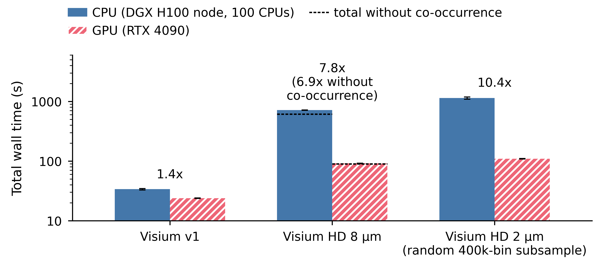
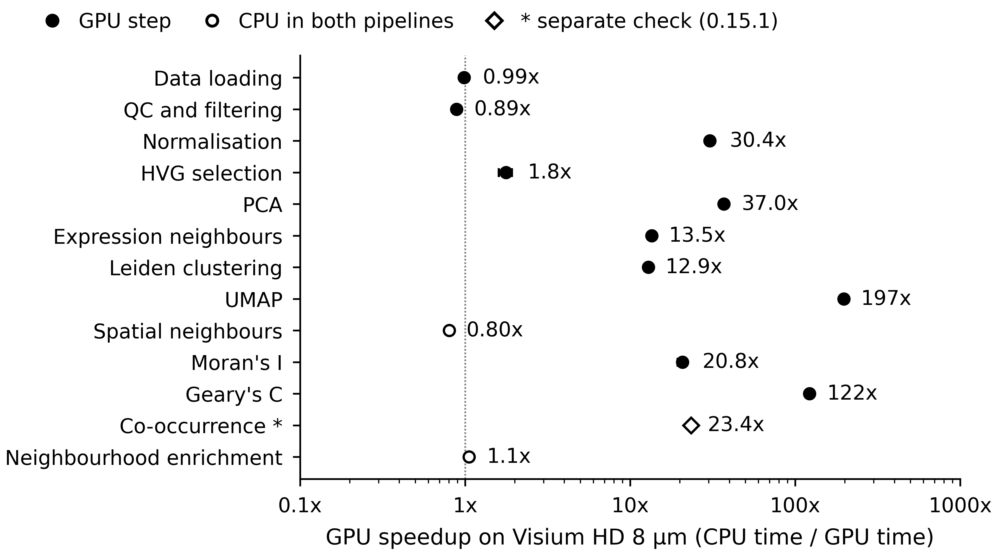
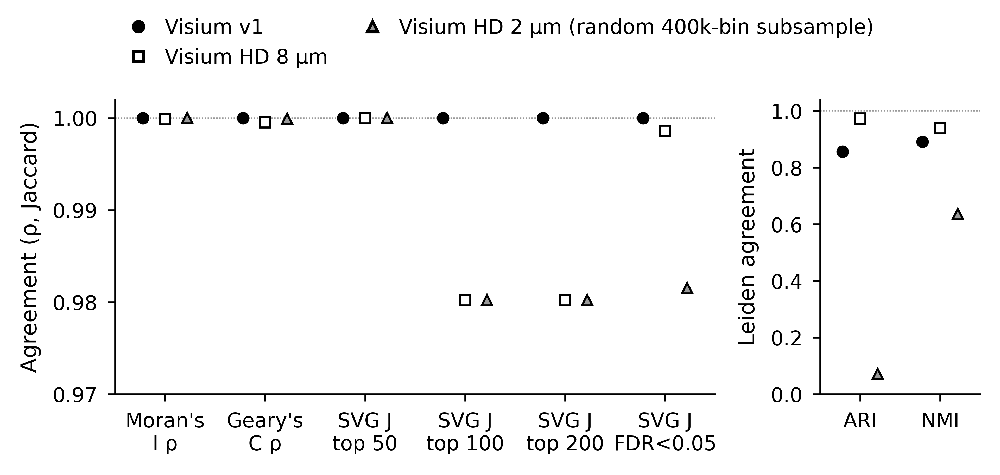

## In breve: i risultati spatial nuovi sono nel capitolo, e i numeri tornano?

**A cosa serviva.** Tabelle, figure e frasi sullo spatial erano ancora quelle dei run di marzo, con la CPU che rallentava fra una ripetizione e l'altra. Questo passo le rifà tutte dal nuovo riferimento (CPU di un nodo DGX, una ripetizione per processo), con le tre scelte che hai fatto all'apertura.

**Cosa abbiamo trovato.**

1. **Tabelle, figure e frasi spatial vengono ora tutte dal nuovo riferimento, e un controllo scritto a parte le ritrova.** Il controllo ricalcola dai file dei risultati i 129 valori disegnati nelle tre figure e 65 gruppi di numeri del testo: nessuna discordanza. Nel capitolo non resta nessuno dei valori di marzo che il piano segnava come superati (51,6x, 3.272x, 162-170x e gli altri). Le figure sono vettoriali alla larghezza della pagina, con gli stessi colori delle figure single-cell.
2. **Gli speedup end-to-end sono 1,4x su Visium v1, 6,9x su Visium HD 8 µm senza co-occorrenza e 10,4x sul sottocampione a 2 µm.** Con la CPU della workstation al posto del DGX diventano 1,6x, 6,1x e 9,4x: la CPU scelta sposta lo speedup del 10-14%, in direzioni diverse. Come hai chiesto, a HD 8 µm la tabella e la figura mostrano i totali completi (7,8x) con la nota, mentre il testo usa il 6,9x.
3. **La co-occorrenza GPU è riportata come difetto corretto.** Con rapids-singlecell 0.14.1 era giusta solo in 8 distanze su 49; con la 0.15.1 è giusta in 49 su 49, nello stesso tempo e 23,4 volte più veloce della CPU del DGX (misura separata, fuori dalla pipeline, come hai scelto).
4. **Le statistiche spaziali coincidono fra CPU e GPU, mentre il clustering sul sottocampione a 2 µm no.** Per Moran e Geary la correlazione non scende mai sotto 0,9995 e i primi 50 geni spazialmente variabili sono gli stessi su tutte e tre le piattaforme. Sul sottocampione a 2 µm il Leiden CPU trova 3.027 gruppi sul DGX e 2.559 sulla workstation, contro 538 sulla GPU (ARI 0,07). Il testo non attribuisce la differenza a una causa.
5. **Lavorando sono emersi due errori, entrambi corretti.** I Metodi dicevano che il ligando-recettore non ha versione GPU: in rapids-singlecell 0.14.1 ce l'ha, ma la pipeline non la usava, e ora il testo lo dice. Le RAM di marzo erano gonfiate dalle ripetizioni nello stesso processo: i valori nuovi vanno da 0,97 a 7,95 GiB, contro 1,3-10,8.

**Cosa devi decidere.** Nulla in questo passo: le tre scelte le hai già fatte all'apertura.

**Comunque.**

- Nel taglio verso le 15 pagine tengo conto che il capitolo è cresciuto di circa 1.400 parole, quasi tutte nelle tabelle e didascalie spatial.
- Quando preparo il LaTeX finale includo le tre figure spatial in PDF alla loro dimensione, le rinumero 5-7 e controllo la larghezza delle tabelle 8 e 10.

Non c'è nulla da decidere: se non hai dubbi, lo step è chiuso.

**Sui tempi di calcolo.** Questo passo ha richiesto circa due ore e mezza (20:05-22:40), senza calcoli pesanti sul server. Restano il taglio con la revisione di stile e il LaTeX con la verifica finale, un giorno ciascuno: il pacchetto per la sottomissione è pronto il 6 o il 7 novembre, con tre o quattro giorni di margine sul 10.

# Dubbi rinviati

- A [taglio e stile (S6)](S6.md): corpo a 12.996 parole (11.590 all'apertura di questo step); la sezione spatial dei Risultati è raddoppiata (2.176 parole, tabelle comprese). Figure spatial 18,2 cm di altezza a dimensione naturale. La copia di stile non contiene i testi nuovi di questo step.
- A [LaTeX e pacchetto METEOR (S7)](S7.md): includere `figures/fig7_spatial_speedup.pdf`, `fig8_spatial_perstep.pdf`, `fig9_spatial_concordance.pdf` a dimensione naturale; rinumerarle 5-7 (voce R0735); controllare nel PDF compilato le righe vuote dopo le figure (voce R0720) e la larghezza di Table 8 (8 colonne) e Table 10 (intestazione lunga della piattaforma a 2 µm); `figures/LEGENDS.md` superato (da togliere o rigenerare).

# Cancelli e previsioni

| id | atteso | osservato | esito |
|---|---|---|---|
| G1 | manifest dei grezzi con 0 differenze all'inizio e alla fine; `SPATIAL/results_v2/` uguale al suo manifest, nessun file mancante mai tracciato | 921 file, 0 differenze, 0 file nuovi all'inizio (21:05) e alla fine (22:02); `SPATIAL/results_v2/`: 380 file presenti tutti uguali al manifest, 109 mancanti mai entrati in git (65 log, 44 tabelle di cluster), 0 errori (`results_v2/S5/manifest*_check_*.json`) | superato |
| G2 | valori delle figure e numeri spatial del testo riletti da codice indipendente, 0 discordanze | 129 valori su 129; 65 controlli su 65 nel testo (Tables 8, 9, 10, didascalie, frasi di Risultati, Discussione, Conclusioni e abstract) (`results_v2/S5/s5_check.json`) | superato |
| G3 | PDF al massimo 12,2 x 19,3 cm, testo di almeno 7 pt, font incorporati, nessun raster, PNG a 800 dpi, md5 uguali in due esecuzioni, serie distinte, colori di CPU e GPU come nelle figure scRNA | larghezza 12,2 cm, altezze 5,6 / 6,8 / 5,8 cm; testo minimo 7,0 pt; DejaVu Sans incorporato; 0 raster; 800 dpi; md5 di PDF e PNG identici fra le due esecuzioni; CPU `#4477AA`, GPU `#EE6677` con tratteggio; serie della Fig. 8 e piattaforme della Fig. 9 distinte per marcatore e riempimento, in nero e grigi | superato |
| G4 | ancore univoche, nessun valore superato, niente lineette, pandoc, 66 righe di diario, OKF | 10 modifiche, ogni ancora presente una volta; 0 valori superati (2,559 compare solo come valore della workstation); 0 lineette; pandoc senza errori (7 figure); 66 righe su 66; OKF superato | superato |
| P1 | VRAM di picco a HD 8 µm e HD 2 µm entro il 5% di 22,6 e diverse meno di 2 SD | 22,74 e 22,73 GiB (entro l'1% di 22,6), SD 0 in entrambe: differenza 0,01 GiB contro 2 SD = 0 | non confermata sul secondo criterio; applicata la conseguenza (due valori separati nel testo); spiegata sotto |
| P2 | RAM di picco del riferimento CPU a Visium v1 e HD 2 µm entro il 20% di 1,3 e 10,8 GiB | 0,97 e 7,95 GiB | smentita; spiegata sotto |
| P3 | ARI HD 8 µm fra 0,96 e 0,98, escursione sotto 0,01 | 0,971-0,974 (escursione 0,003) | confermata |
| P4 | speedup della verifica della co-occorrenza fra 21,1x e 25,7x | 23,4x [23,3; 23,6] | confermata |
| P5 | altezza delle figure 7-9 fra 15 e 20 cm | 18,2 cm (contro 19,1 cm delle vecchie PNG a 12,2 cm) | confermata |

Criteri completi, scritti prima dei calcoli: `docs/steps/S5.md`, sezione «Attese pre-registrate» (commit `fe1e438`).

# Dubbi e come si sono chiusi

- **Ligando-recettore su GPU (corretto).** I Metodi (riga 136 e Table 3) dicevano che il ligando-recettore non ha un'implementazione GPU. Nel contenitore spatial `rsc.gr` di rapids-singlecell 0.14.1 contiene `ligrec`, `co_occurrence` e `spatial_autocorr`, non `nhood_enrichment` né `spatial_neighbors`. La pipeline GPU chiama `sq.gr.ligrec` (Squidpy, CPU). Ora i Metodi dicono che la versione GPU esiste e non è stata usata (modifiche M1, M2; codice S5-N1 nel diario delle voci R0613).
- **File mancanti nel manifest di `SPATIAL/results_v2/` (spiegato).** Il manifest di S1 elenca l'intera uscita dei run; 65 log (esclusi da `.gitignore`) e 44 tabelle di cluster delle ripetizioni 2-5 e del controllo non sono mai entrati in git (storia vuota). Il criterio di G1 è stato precisato prima del commit della pre-registrazione: conta come errore una differenza di byte o md5, oppure un file mancante che git abbia mai tracciato.
- **VRAM con SD zero (spiegato, previsione P1).** I JSON registrano la VRAM con 2 decimali e le 5 ripetizioni danno lo stesso valore, quindi la SD è 0 e nessuna differenza può stare entro 2 SD. 22,74 e 22,73 GiB differiscono di un'unità dell'ultima cifra. Conseguenza pre-registrata applicata: il testo dà i due valori e non scrive «stesso plateau».
- **RAM CPU più bassa che a marzo (spiegato, previsione P2).** A marzo le 5 ripetizioni giravano nello stesso processo e la RAM cresceva: CPU a HD 2 µm 8,41, 9,22, 10,81, 11,99, 13,43 GiB nelle ripetizioni 1-5; Visium v1 1,07 e poi 1,32-1,33 GiB (`SPATIAL/results/spatial_cpu_*_r*_results.json`). Con un processo nuovo per ripetizione i picchi sono 0,97 e 7,95 GiB sul DGX e 1,07 e 8,09 GiB sulla workstation, vicini alla prima ripetizione di marzo. La frase dei Metodi sui processi nuovi c'è già.
- **Pre-registrazione committata al quinto tentativo (spiegato).** Il testo delle previsioni è quello delle 21:00. I tentativi falliti erano dovuti alla chiusura del frontmatter, a un codice di decisione senza link e al titolo di D-20, che conteneva un codice di step. Il solo cambiamento di sostanza, fatto prima del commit, è il criterio di G1 descritto sopra. Commit `fe1e438`.
- **Modifiche fuori dalle voci (decise, registrate).** Il titolo della sottosezione sulla concordanza passa da «at high resolution» a «on the Visium HD 2 um subsample» (scelta HD2UM in [Scelte di contenuto di S3: approvate le 21 raccomandazioni (D-19)](../decisions/D-19.md)); «four complementary axes» diventa «five axes», perché si aggiungono co-occorrenza e arricchimento di vicinato; tolta «not a deficiency of GPU computation per se» (causa non verificata). Ognuna sta nel diario della voce collegata (R0365, R0343, R0694).
- **Lunghezza (rinviato).** Il corpo del capitolo passa da 11.590 a 12.996 parole; la sezione spatial dei Risultati da 1.150 a 2.176, soprattutto per le tabelle 8-10 con SD e intervalli e per le didascalie. Rinviato a [taglio e stile (S6)](S6.md).
- **`figures/LEGENDS.md` (rinviato).** Il file contiene ancora le didascalie dello short paper (multi-GPU, valori di marzo) e il manoscritto non lo usa. Rinviato a [LaTeX e pacchetto METEOR (S7)](S7.md).

# Le figure

Anteprime PNG a 800 dpi dei PDF vettoriali, alla dimensione di stampa. Numerazione attuale del manoscritto (diventano 5-7 in S7).

Cosa guardare: a Visium HD 8 µm la linea tratteggiata sulla barra CPU è il totale senza co-occorrenza; la distanza dalla cima della barra (103 s su 719 s) è la parte che fa passare lo speedup da 6,9x a 7,8x.

Cosa guardare: i due cerchi vuoti (step su CPU in entrambe le pipeline) stanno intorno a 1x; il rombo vuoto della co-occorrenza viene dalla verifica separata con la 0.15.1, non dalla pipeline.

Cosa guardare: nel pannello sinistro tutti i punti stanno sopra 0,98; nel pannello destro il triangolo del sottocampione a 2 µm crolla sull'ARI (0,07) ma non sull'NMI (0,64), segno di partizioni con granularità molto diversa.

# Modifiche al manoscritto

Manoscritto: md5 `333c0e935307c09db60d716b4a65eaaa` prima, `2e6c57413bcfd70ef152a7fbbb5982bf` dopo (`results_v2/S5/edits_applied.json`). Ogni numero è formattato da `results_v2/S5/s5_numbers.json`. Il blocco R1 sostituisce in una sola transazione la sezione spatial dei Risultati, dal titolo alla frase sulla memoria. Diario: 66 righe in `manuscript/revisione_n2/piano/IMPL_diario.csv` (63 fatte, 3 decise diversamente per [Scelte del PI per l'integrazione spatial (D-20)](../docs/decisions/D-20.md): R0282, R0285, R0361).

| modifica | voci | prima | dopo |
|---|---|---|---|
| R1 | Results spatial (R0280 ... R0720) | ### GPU speedup scales dramatically with platform resolution  Table 8 summarises the spatial benchmark results across three Visium platforms.  : **Table 8.** Sp ... | ### End-to-end and per-step GPU speedup on three Visium platforms  Table 8 summarises the spatial benchmark on the three platforms.  : **Table 8.** Spatial tran ... |
| M1 | S5-N1 (rsc.gr.ligrec presente in 0.14.1) | \| 14 \| Ligand-receptor interaction \| No \| Squidpy re-implementation of CellPhoneDB [@Palla2022] \| | \| 14 \| Ligand-receptor interaction \| Not used \| Squidpy re-implementation of CellPhoneDB [@Palla2022]; the GPU version in rapids-singlecell 0.14.1 was not u ... |
| M2 | S5-N1; D-16 (vicini spatial a 1 thread) | Steps without GPU implementations (spatial neighbours, neighbourhood enrichment, ligand-receptor) were executed identically on CPU in both pipelines. | Spatial neighbours and neighbourhood enrichment, which have no GPU implementation in rapids-singlecell 0.14.1, and ligand-receptor analysis, whose GPU implement ... |
| M3 | R0343; R0701; D-15 | Finally, co-occurrence concordance was the Spearman rho between the full CPU and GPU co-occurrence matrices. | Co-occurrence and neighbourhood enrichment concordance were the Spearman rho between the full CPU and GPU matrices, computed on the same cell groups; for co-occ ... |
| D1 | R0572; D-20 | The extension to spatial transcriptomics shows that GPU advantages are even more pronounced for spatial-specific operations, with co-occurrence analysis achievi ... | The spatial benchmark, repeated with a fresh process per repeat and the same cell groups on CPU and GPU, gave end-to-end speedups of 1.4x (Visium v1), 6.9x (Vis ... |
| D2 | R0610; R0611; R0612; R0613; R0555; R0713; D-20 | Beyond scRNA-seq, the extension to spatial transcriptomics demonstrates that GPU acceleration becomes increasingly impactful for computationally intensive spati ... | In the spatial benchmark, the GPU advantage was concentrated in a few steps rather than spread across spatial statistics as a whole. At Visium HD 8 um, GPU co-o ... |
| D3 | R0615; R0616; R0617; R0337 | A notable finding from spatial analysis concerns clustering at extreme resolution. The dramatic divergence at Visium HD 2 um (ARI = 0.080) is not specific to GP ... | A notable finding from spatial analysis concerns clustering on the Visium HD 2 um subsample. At 389,492 spatial bins and resolution 0.1, the igraph (CPU) and cu ... |
| C1 | R0340 | For spatial transcriptomics, GPU acceleration delivers 51.6x end-to-end speedup on Visium HD, with co-occurrence analysis achieving a 3,272x speedup and spatial ... | For spatial transcriptomics on one RTX 4090, end-to-end speedups against a 100-CPU DGX node were 1.4x on Visium v1, 6.9x on Visium HD 8 um with co-occurrence ex ... |
| A1 | R0382 | All code, Dockerfiles, SLURM submission scripts, and benchmark result JSON files are available at <https://github.com/lucavd/2026.scRNA_DGX>. | All code, Dockerfiles, SLURM submission scripts, benchmark result JSON files and the scripts that generate every figure are available at <https://github.com/luc ... |
| M4 | R0343 (co-occurrence and neighbourhood enrichment) | We compared CPU and GPU spatial outputs along four complementary axes. | We compared CPU and GPU spatial outputs along five axes. |

# Cosa è girato

| cosa | dettaglio |
|---|---|
| commit | pre-registrazione `fe1e438`; lavoro `b19b1e9`; chiusura nel commit di questo report |
| numeri | `tools/s5_numbers.py` (md5 `e778f6d8590d76ac74912af311528613`): 386 grandezze da 55 file di `SPATIAL/results_v2/` con md5 e chiave |
| figure | `scripts/generate_spatial_figures.py` (md5 `125cf038afa179dc3d507aabe06fb8e1`), circa 5 s; due esecuzioni con PDF e PNG identici (`results_v2/S5/figure_md5_two_runs.txt`) |
| modifiche | `tools/s5_apply.py` (md5 `07dc8883305a48e57d623f3273a2c268`) con `tools/s5_diary.py` (md5 `b6e29270d8221b560dce53864ce52403`) |
| controllo | `tools/s5_check.py` (md5 `db26531946c2fd531cb787411ae9bb4b`), libreria standard più PyMuPDF; il bootstrap della co-occorrenza è rifatto con un altro generatore e confrontato con tolleranza dell'1% |
| manifest | `tools/check_manifest.py` (921 file) e `tools/check_manifest_v2.py` (md5 `6af7a59ac2a82ea7c10d65996534b458`, 489 file) all'inizio e alla fine |
| PDF | `figures/fig7_spatial_speedup.pdf` `cad2a61cf3ec0e94de4a15bc6e2b43ef`; `fig8_spatial_perstep.pdf` `0ea87f0200b2e1166d0f440ecfe18911`; `fig9_spatial_concordance.pdf` `cb87da4824c069dcf644344acb9b4d69` |
| contenitore | `lucavd/sc-benchmark-spatial:latest`, letto solo per l'API di rapids-singlecell 0.14.1 (`rsc.gr`, firma di `rsc.tl.leiden`) e il sorgente di `_occur_count` di Squidpy 1.8.1 |
| ambiente | `/tmp/lnbi_s4_venv` (Python 3.12, matplotlib 3.10.9, numpy 2.2.6, pymupdf 2.1; `scripts/requirements_figures.txt`) |
| vecchi file | `figures/generate_spatial_figures.py`, `GENERATION_SUMMARY.md` e `SPATIAL_FIGURES_README.txt` di aprile in `figures/retired/` |
| macchina | server condiviso, carico 33-42 (geo_spatialtrans e la meta-analisi del PI); nessun tempo misurato in questo step |

# Appendice: da dove vengono i numeri del riassunto

| frase del riassunto | file e chiave | valore letto |
|---|---|---|
| 129 valori, 65 gruppi di numeri, nessuna discordanza | `results_v2/S5/s5_check.json`, `summary` | G2_values 129/129, G2_text 65/65 |
| nessuno dei valori superati | `results_v2/S5/s5_check.json`, `G4.superseded_found` | vuoto |
| 1,4x, 10,4x | `SPATIAL/results_v2/s1_speedups.csv`, step total, reference_dgx, 1_5 | 1,41385; 10,42614 |
| 6,9x senza co-occorrenza | `SPATIAL/results_v2/s1_extra_numbers.json`, `speedup_total_without_co_occurrence.visium_hd_square_008um.reference_dgx[0]` | 6,86855 |
| 1,6x, 6,1x, 9,4x | stessi file, control_server | 1,60726; 6,07912; 9,39191 |
| 10-14% | rapporto controllo/riferimento per piattaforma | +13,7%; -11,5%; -9,9% |
| 7,8x con i totali completi | `s1_speedups.csv`, visium_hd_square_008um, total, reference_dgx | 7,79813 |
| 8 distanze su 49, 49 su 49 | `SPATIAL/results_v2/cooc_check/cooc_check_eval.json`, `hd8_rsc0141_equal_intervals`, `Q1_hd8_rsc0151_equal_intervals` | 8 (x5); 49 (x5) |
| stesso tempo | `cooc_check_eval.json`, `Q3_ratio`, `Q3_ci` | 0,983 [0,951; 1,004] |
| 23,4 volte | `results_v2/S5/s5_numbers.json`, `cooc.check_speedup_dgx_rsc0151` | 23,409 [23,268; 23,561] |
| correlazione non sotto 0,9995 | minimo dei rho di Moran e Geary nei 3 JSON di `concordance_reference/` | 0,999526 (Geary, HD 8 µm) |
| primi 50 geni uguali | `concordance_reference/*.json`, `moranI.svg_jaccard_top50` | 1,0 in 15 coppie su 15 |
| 3.027, 2.559, 538 gruppi | `s1_extra_numbers.json`, `own_leiden_clusters.visium_hd_square_002um` | 3027 (x5), 2559 (x5), 538 (x5) |
| ARI 0,07 | `concordance_reference/spatial_concordance_visium_hd_square_002um.json`, `clusters.ari` | 0,0708 (x5) |
| ligando-recettore con versione GPU | `rsc.gr` nel contenitore spatial | ['annotations', 'co_occurrence', 'kernels', 'ligrec', 'spatial_autocorr'] |
| RAM 0,97-7,95 GiB contro 1,3-10,8 | `s5_numbers.json`, `run.dgx_cpu.*.peak_ram_gb`; testo di marzo (Table 8 all'apertura) | 0,97; 7,95; 1.3; 10.8 |
| circa 1.400 parole in più | conteggio delle parole del corpo, da Introduction a Conclusions, prima e dopo | 11.590; 12.996 |
| circa due ore e mezza | `uptime` all'apertura (20:08) e render del report | 20:08-22:40 circa |
